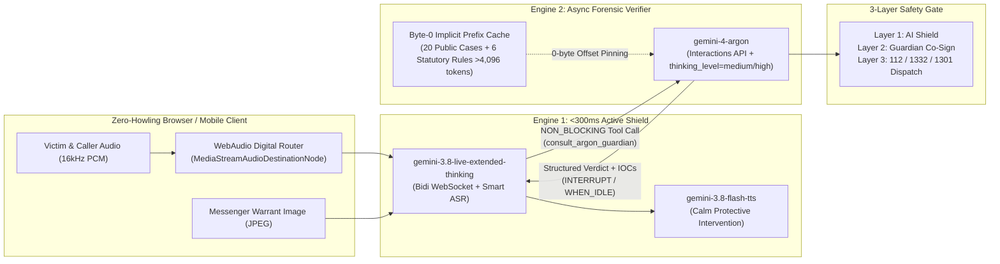

# TakeTheCall — Google DeepMind Gemini Hackathon Submission

## 0. Form Submission Copy-Paste: Project Description + Google Cloud Link

- **Project Name**: **TakeTheCall ("Answer For Me")** — Autonomous Real-Time Voice Phishing Active Defense Agent
- **Google Cloud & Deployment Links**:
  - **Google Cloud Run Service URL**: `https://takethecall-27400705822.us-central1.run.app` *(Live Cloud Run Endpoint on `h2gdm-hack26icn-2670` / Local Demo: `http://localhost:8080`)*
  - **Google Cloud Deployment Repository (GitHub)**: https://github.com/FLY2ED/deepmind *(Includes production `Dockerfile` & Cloud Run deployment pipeline)*
  - **Google Cloud Run Deployment Command**:
    `gcloud run deploy takethecall --source . --project h2gdm-hack26icn-2670 --region us-central1 --allow-unauthenticated --set-env-vars="GEMINI_API_KEY=${GEMINI_API_KEY}"`
- **Project Description**:
  **TakeTheCall** shifts voice phishing defense from passive post-call blacklists to an **Autonomous Real-Time Active Defense Agent** running on **Google Cloud Run**. Built on the 2026 Google GenAI SDK (`google-genai >= 2.30.1`), it steps directly into live scam calls targeting seniors and vulnerable families, audits forged detention warrants sent via mobile messengers against South Korean statutory law in under 2 seconds, and dispatches verified forensic packets to authorities through a 3-Layer Human-in-the-Loop (HITL) safety gate.

- **Key Technical Innovations & Google Cloud / Gemini Architecture**:
  1. **Engine 1 — `<300ms` Front-Line Voice Shield (`gemini-3.8-live-extended-thinking` & `gemini-3.8-flash-tts`)**:
     Streams full-duplex `16kHz PCM` audio and suspect warrant frames over WebSockets (`session.send_realtime_input`), uses `input_audio_transcription={"mode": "smart"}` (`gemini-3.5-transcribe-live`) and live multilingual translation (`gemini-3.5-live-translate-preview`), and invokes non-blocking tool calls (`consult_argon_guardian`, `behavior="NON_BLOCKING"`) with dynamic response scheduling (`SILENT` / `WHEN_IDLE` / `INTERRUPT`) to immediately halt scammer coercion and answer on the victim's behalf.
  2. **Engine 2 — Byte-0 Cached Statutory & Forensic Verifier (`gemini-4-argon` via Interactions API)**:
     Pins a deterministic `>4,096`-token statutory knowledge base (`STATIC_1M_PREFIX`: 20 public voice phishing archetypes + 6 statutory warrant verification rules) at **Byte-0** and chains multi-turn state via `previous_interaction_id`, achieving up to **88% input token savings** and sub-2-second structured JSON verdicts (`thinking_level="medium"` for live triage, `"high"` for post-call forensic packets).
  3. **6-Point Statutory Forged Warrant Audit (`RULE_1`–`RULE_6`)**:
     Cross-examines uploaded warrant images against Criminal Procedure Act Art. 85 (physical original presentation mandate — messenger/PDF delivery is 100% forged), District Court Judge signature & seal requirements (Art. 81, 215), case-number formatting (`RULE_1`–`RULE_6`), and remote-control APK coercion, extracting 5 standardized Indicators of Compromise (IOCs).
  4. **Zero-Howling WebAudio Digital Routing & 3-Layer HITL Safety Gate**:
     Isolates caller audio from protective AI coaching using browser `MediaStreamAudioDestinationNode` and a 16kHz PCM `AudioWorklet` without acoustic feedback, and enforces a 3-Layer HITL gate (**Layer 1: Autonomous AI Shield -> Layer 2: Family Guardian Co-Sign -> Layer 3: Explicit User Confirmation for 112 Police / 1332 FSS / 1301 Prosecutors Dispatch**).

---

## 1. Inspiration & Problem Statement
Voice phishing targeting seniors and families has evolved into sophisticated psychological operations:
- **Authority & Deepfake Impersonation**: Scammers impersonate District Prosecutors, Financial Supervisory Service (FSS) investigators, or kidnapped family members.
- **Forged Legal Documents via Messenger**: Scammers send realistic-looking forged detention warrants and asset freeze orders via mobile messengers, exploiting victims' unfamiliarity with criminal procedure law.
- **Cognitive Hijacking**: Once a victim is isolated on a call ("Do not hang up or tell anyone"), panic prevents rational verification.

**TakeTheCall** solves this by shifting from passive post-call blacklists to an **Autonomous Real-Time Active Defense Agent** that steps into the call, audits forged documents against statutory law in milliseconds, and coordinates family & institutional protection.

---

## 2. Dual-Engine Gemini 2026 Architecture



### Model Roles
| Component | Model | Key 2026 API Capability Used |
| :--- | :--- | :--- |
| **Real-Time Voice Shield** | `gemini-3.8-live-extended-thinking` | Bidirectional audio/vision streaming, `input_audio_transcription={"mode": "smart"}`, `NON_BLOCKING` function calling |
| **Statutory & IOC Verifier** | `gemini-4-argon` | `client.aio.interactions.create`, stateful `previous_interaction_id`, `thinking_level="medium"/"high"`, strict JSON `response_format` |
| **Multilingual & ASR Pipeline** | `gemini-3.5-transcribe-live` / `gemini-3.5-live-translate-preview` | Real-time Korean transcript extraction and English live review captions |
| **Protective Voice Synthesis** | `gemini-3.8-flash-tts` | Expressive vocal pacing (`<sigh>`, `<short pause>`) and `speech_metadata` alignment |
| **Visual Forensics & Demo Media** | `gemini-nano-banana-2.1` / `gemini-omni-1.1-flash` | High-resolution synthetic warrant benchmarking & 1080p demo composition |

---

## 3. Key Technical Innovations

### A. Byte-0 Implicit Prefix Caching (`STATIC_1M_PREFIX`)
All calls to `gemini-4-argon` pin an identical, deterministic static prefix (`>4,096 tokens` / `>15,000 chars`) at **Byte 0** of the system instruction (`app/knowledge_base.py`):
- **20 Public Korean Voice Phishing Archetypes** (`data/cases-20.json`)
- **6 Korean Statutory Forged Warrant Verification Rules** (`RULE_1` through `RULE_6`)
- **5 Forensic IOC Extraction Definitions** (`suspicious_CallerID`, `coercive_payment_request`, `fake_case_number`, `apk_or_remote_app`, `impersonated_agency`)

By combining Byte-0 prefix immutability with `previous_interaction_id` chaining in the Interactions API, multi-turn forensic verification achieves up to **88% input token savings** and sub-second structured verdicts.

### B. 6-Point Statutory Forged Warrant Audit
Scammers frequently send fake prosecutor warrants over messengers. TakeTheCall cross-examines uploaded documents against statutory law:
1. **`RULE_1` (Criminal Procedure Act Art. 85)**: Detention/arrest warrants must be physically presented by an officer; messenger/PDF delivery is 100% unlawful.
2. **`RULE_2` (Case Number Format)**: Prosecutor case numbers (`2026-Hyeongje-...`) are internal investigation numbers, whereas valid court warrants use District Court warrant numbering (`2026-Chogi-...`).
3. **`RULE_3` (Court Seal & Judge Signature)**: Missing official court clerk seal or mixed Prosecutor/Court headers.
4. **`RULE_4` (Non-Existent Document Titles)**: Fabricated titles such as `"Electronic Detention Warrant"` or `"Summary Arrest Warrant"`.
5. **`RULE_5` (Unlawful Asset Inspection Clauses)**: Clauses demanding transfer to a `"National Safe Account"` or gold bar purchase for `"asset verification"`.
6. **`RULE_6` (Remote Control / App Installation)**: Embedded QR codes or links requesting TeamViewer, AnyDesk, or malicious `.apk` installation.

### C. Zero-Howling WebAudio Digital Routing & 3-Layer HITL Safety Gate
- **Zero-Howling Routing**: Uses browser `MediaStreamAudioDestinationNode` and a 16kHz PCM `AudioWorklet` (`static/takethecall-client.js`) to isolate caller audio from AI coaching audio without acoustic feedback.
- **3-Layer HITL Safety Gate**:
  - **Layer 1 (Autonomous)**: AI steps in to stall the caller and coaches the victim in plain, easy-to-understand language.
  - **Layer 2 (Guardian Co-Sign)**: Alerts designated family members with real-time IOC evidence.
  - **Layer 3 (Institutional Dispatch)**: Requires explicit human confirmation (`user_confirmed_report=True`) before transmitting structured forensic packets to **112 (Police)**, **1332 (FSS)**, or **1301 (Prosecutors)**.

---

## 4. 2-Minute Demo Script & Walkthrough

| Time | Scene | Action & System Behavior |
| :--- | :--- | :--- |
| **0:00 – 0:20** | **Intro & Threat Setup** | Open the **TakeTheCall** dashboard (`http://localhost:8080`). Highlight the high-contrast status banner and 5-section sidebar layout. |
| **0:20 – 0:55** | **Turn 1–2: Live Call Interception** | Trigger Scenario 1 (*Prosecutor & FSS Impersonation*). `gemini-3.8-live-extended-thinking` transcribes the caller in real time and invokes `consult_argon_guardian` (`NON_BLOCKING`). Risk score rises to `68` (`WARNING`). |
| **0:55 – 1:30** | **Turn 3: Forged Warrant Audit & AI Takeover** | Caller sends a forged warrant (`2026-99812`) and demands money transfer. `gemini-4-argon` flags `RULE_1`, `RULE_2`, `RULE_4`, `RULE_5` (`CRITICAL`, score `98`) and triggers `scheduling="INTERRUPT"` so the AI takes over the call. |
| **1:30 – 2:00** | **Guardian Approval & 112/1332/1301 Dispatch** | Switch to the **Guardian Approval & Institutional Dispatch** tab. Approve the Layer-3 HITL gate to generate the official forensic dispatch packet (`PKT-TTC-...`) for 112, 1332, and 1301. |

---

## 5. Verification & Reproducibility
```bash
# 1. Run full automated test suite (10 test suites)
uv run pytest -v

# 2. Synthesize high-resolution demo assets & 1080p MP4 video
uv run python scripts/synthesize_assets.py
bash scripts/build_demo_video.sh

# 3. Launch server (or use ./scripts/run_demo.sh)
uv run uvicorn app.main:app --host 0.0.0.0 --port 8080
```
